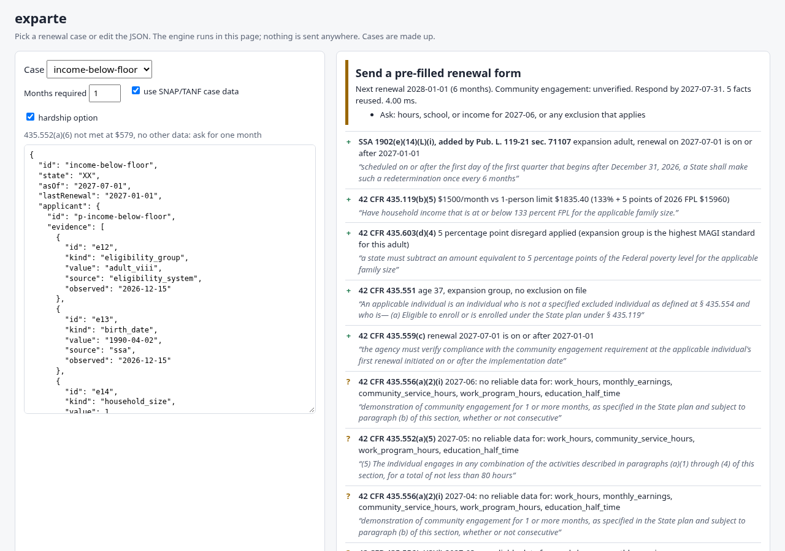

# exparte

Decide a Medicaid renewal from the data an agency already has, and show the exact regulation sentence behind every step.

**[Try it in the browser](https://tahakocp.github.io/exparte/)** (runs locally in the page, made-up cases)



From 2027, expansion adults on Medicaid must be renewed every 6 months instead of every 12 (Pub. L. 119-21 sec. 71107) and must show 80 hours a month of work, school, service or a work program, or matching income, unless an exclusion applies (sec. 71119, now 42 CFR 435.550-563). States are required to check this from data they already hold before asking the person. exparte is a small TypeScript engine for that check:

- input: one person's facts, each with a source and a date (payroll, SWICA wages, the SNAP case, claims, school records, ...)
- output: renew without asking, send a pre-filled form that asks only for what is missing, a 30-day noncompliance notice, or "over the income limit, check other groups first"
- every step in the trace carries the citation and the verbatim sentence it relies on, and the test suite fails if that sentence is not found in the pinned copy of the official text

It started from the "Plaid for government benefits" idea on YC's request-for-startups list; it has no connection to YC.

## Use it

```sh
npm install github:tahakocp/exparte
npx exparte node_modules/exparte/examples/snap-member.json
npx exparte my-cases.json --policy examples/state-3-months.json --json
```

```js
import { decide, explain, EXAMPLE_POLICY } from "exparte";
const d = decide(renewalCase, { ...EXAMPLE_POLICY, ceMonthsRequired: 3 });
d.outcome;   // "send_prefilled_form"
d.requests;  // [{ kind: "work_hours", month: "2027-06", cite: "42 CFR 435.557(b)(2)", ... }]
console.log(explain(d));
```

Output for a SNAP household member (excluded under 435.554(c)(7), fact taken from the SNAP case):

```
case snap-member: renew_ex_parte
  next renewal 2028-01-01 (6-month period), community engagement: excluded
+ SSA 1902(e)(14)(L)(i), added by Pub. L. 119-21 sec. 71107: expansion adult, renewal on 2027-07-01 is on or after 2027-01-01
+ 42 CFR 435.119(b)(5): $1500/month vs 1-person limit $1835.40 (133% + 5 points of 2026 FPL $15960)
+ 42 CFR 435.554(c)(7): on file from a listed source
+ 42 CFR 435.916(a)(2): all criteria verified from information the agency already has
+ 42 CFR 435.948(a)(2): 1 fact(s) reused from SNAP/TANF case records
```

## How it works

A case is a list of facts (`Evidence`): kind, value, source, the day it was observed, and the month it describes. A state policy says which sources its verification plan lists as reliable (435.557(b)(1)(iii)), how many months it requires (435.556(a)(2), 1 or more), whether it uses the hardship option (435.555), and how old each kind of fact may be. Claims and encounter data are capped at 12 months by 435.557(a); the other age limits are the state's call and are set in one table.

The engine then:

1. picks the renewal period: 6 months for the expansion group from 2027-01-01, 12 for everyone else, and 12 for American Indians and Alaska Natives (1902(e)(14)(L)(ii));
2. checks MAGI income against 133% FPL plus the 5-point disregard (435.119(b)(5), 435.603(d)(4)), 2026 HHS guidelines;
3. checks the ten exclusions in 435.554(c) (medically frail may be self-attested, the rest need a listed source);
4. walks the months since the last renewal, newest first, and stops as soon as the state's required count is met. Each month is deemed (under 19, Medicare, inmate in the last 3 months, hardship) or met by one of the seven tests in 435.552(a), or it is unknown;
5. asks only for the months still short (435.916(e), 435.556(b)), never for more.

`sources/` holds the regulation and statute text as fetched from the eCFR API (version of 2026-11-01) and govinfo (PLAW-119publ21), with a `SHA256SUMS` file. 44 rules quote 15 of the 24 files. If a source changes, CI fails until someone re-pins it and re-reads the affected quotes.

## Numbers

| What | Result |
|---|---|
| Test cases, each built from one clause | 18 fixtures + 4 other tests (quote check, source hashes, reachability, request count), all passing on Node 20, 22, 24 |
| Rules with a verbatim quote checked against the pinned text | 44 / 44 |
| Engine speed, synthetic population, 1 core of a Xeon VM | about 30,000-39,000 decisions/s |
| Browser bundle | 33 KB of JavaScript, no dependencies |

A synthetic population of 100,000 expansion adults (`npm run bench`, rates are assumptions printed with the output, not data):

| Verification plan | Renewed without asking | Items asked per person |
|---|---|---|
| Medicaid-side data only (payroll, SWICA, SSA, claims, school) | 44.8% | 0.62 |
| Same, plus SNAP and TANF case records | 55.8% | 0.50 |

The gap comes from one rule: a SNAP household member who is subject to SNAP work rules is excluded (435.554(c)(7)), and that fact lives in the SNAP case. With these assumptions 21.8% of people had a fact reused from another program. The size of the gap depends entirely on the assumed rates.

## Compared with existing work

- [PolicyEngine US](https://github.com/PolicyEngine/policyengine-us) (177 stars) models the community engagement test as yearly person variables for microsimulation: will this person pass. It has no renewal period, no per-month evidence with sources and ages, and no "what must we ask for" output. Use it for policy impact; exparte is about the casework decision.
- [OSCER](https://github.com/navapbc/oscer) by Nava (26 stars) is a full Rails application for states to collect activity reports and manage exemptions. exparte is a library that could sit under such a system; it has no UI for caseworkers and no storage.
- [OpenFisca](https://github.com/openfisca/openfisca-core) (252 stars) and [Catala](https://github.com/CatalaLang/catala) (2,453 stars) are general rules-as-code tools. Catala puts the law text next to the code. I did not find a check of that text against a hashed official copy in either, or these Medicaid rules.
- [HHSIDEAlab/medicaid_eligibility](https://github.com/HHSIDEAlab/medicaid_eligibility) (18 stars) is a 2014 MAGI income calculator.

As far as I could find (GitHub search, 2026-11-24), no open project decides the ex parte renewal itself under the 2027 rules.

## Limits

- Not legal advice and not tested by any agency or on real cases. All cases are made up.
- Federal rules only. No real state's plan is modeled; `EXAMPLE_POLICY` is an invented state "XX". State choices (months required, data sources, age limits) must be filled in from the state plan.
- Not modeled: non-MAGI groups beyond "12 months", the full MAGI household rules in 435.603 (household size is taken as given), reasonable compatibility thresholds (435.952(c)(1)), the more-frequent verification option (435.557(d)), changes in circumstances between renewals, the 2028 documentation rule (435.557(b)(2)(ii)), notices and fair hearings.
- The "30 days" is counted from the processing date; the rule counts from when the person receives the notice.
- Months before 2027-01 are not counted toward community engagement. If the renewal falls in January 2027, the engine looks at December 2026; check that against CMS guidance for your state.
- SNAP and TANF appear only as sources of facts. Their own recertification rules are not modeled yet.

## Layout

```
src/rules.ts      every rule: id, citation, source file, verbatim quote
src/engine.ts     decide(case, policy) -> outcome, period, requests, trace
src/evidence.ts   which facts are usable (source listed, not too old)
src/policy.ts     state choices, 2026 FPL, $7.25 minimum wage
sources/          pinned regulation and statute text + SHA256SUMS
fixtures/         make.mjs writes cases.json; each case names its clause
bench/            synthetic population simulation
site/             the browser demo
```

Corrections from people who work on renewals are the most useful contribution: a wrong reading of a rule, a missing exclusion, or a fixture that should decide differently. Open an issue with the citation.

MIT license. Regulation and statute text in `sources/` is a US government work in the public domain.
